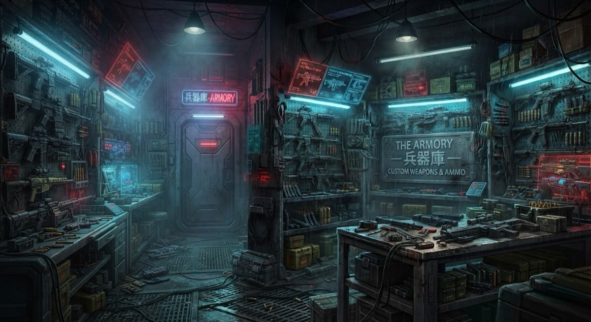

<p align="center">
  
</p>

<h1 align="center">armory.ai</h1>

<p align="center">
  <em>"Guns. Lots of guns."</em><br>
  My personal AI toolkit: skills, agents, settings, templates, notes.
</p>

<p align="center">
  
  
  
</p>

---

Like the armory in The Matrix: the place I come back to before a mission, pick what I need and load it.

## Loadout

| Folder | What lives there |
|---|---|
| [`skills/`](skills) | Reusable procedures (`skills/<name>/SKILL.md`) |
| [`agents/`](agents) | Subagent definitions |
| [`commands/`](commands) | Slash commands |
| [`settings/`](settings) | `settings.json` fragments: permissions, hooks, env |
| [`templates/`](templates) | `AGENTS.md` / `CLAUDE.md` to copy into new repos |
| [`notes/`](notes) | Dated experiments: models, costs, what worked |

## Using it

Copy what you need into a project, or link a folder into `~/.claude/` so this repo stays the single source of truth.

```bash
# new project: start from the templates
cp templates/AGENTS.md templates/CLAUDE.md /path/to/project/

# global skill: symlink instead of copying
ln -s "$PWD/skills/<name>" ~/.claude/skills/<name>
```

## Rules of the armory

- Add an item only when it is needed a second time.
- No secrets, tokens or machine-specific paths. Local overrides live in git-ignored `*.local.*` files.
- Notes are dated; they age better than memory.

## License

[MIT](LICENSE)
